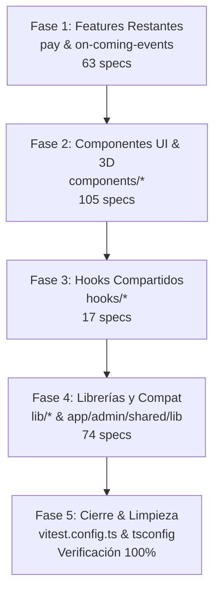

# Plan de Migración de Tests: Centralización Total de `src/` a `test/`

> **Proyecto:** `shamell-frontend`  
> **Estado:** Fase Final de Migración QA  
> **Objetivo:** Mover los 259 specs restantes y su infraestructura de soporte ubicados en `src/` hacia el árbol central `test/`, desacoplando completamente las pruebas del código de producción y consolidando una única fuente de verdad para QA.

---

## 1. Diagnóstico y Estado Actual

El frontend inició la migración con el módulo piloto `about` (documentado en [`migracion-tests-about.md`](file:///d:/shamell-entertainment-web/shamell-frontend/migracion-tests-about.md)) y ya migró con éxito:
- **659 specs** en `test/`:
  - Los 17 módulos de administración en `features/admin/` (592 specs).
  - Los módulos públicos `contacto` (39 specs), `forgot-password` (13 specs) y `gallery` (15 specs).
  - Infraestructura global consolidada en [`test/support/`](file:///d:/shamell-entertainment-web/shamell-frontend/test/support/).

### Inventario de los 259 Specs Pendientes en `src/`:

| Cluster / Directorio | Specs | Descripción |
| :--- | :---: | :--- |
| **`components/`** | **105** | UI compartida, componentes admin de diseño, y render 3D (`venue-3d`: 40, `admin`: 25, `shared`: 22, `home`: 7, `catalog`: 4, `stripe`: 3, `floor-layout`: 2, `experiences`: 1, `media`: 1) |
| **`lib/`** | **69** | Lógicas puras, clientes API y helpers (`on-coming-events`: 11, `admin`: 7, `agenda`: 6, `hero`: 6, `stripe`: 5, `about`: 4, `contacto`: 4, `gallery`: 4, `header-media`: 4, `services`: 4, `theme`: 3, `home`: 2, utilidades individuales: 9) |
| **`features/on-coming-events`** | **55** | Vistas públicas, modals de compra/checkout, calendario, grillas de clases y su infraestructura en `test/` |
| **`hooks/`** | **17** | Hooks compartidos (`use-about-content`, `use-in-view`, `use-mobile`, `use-experiences`, etc.) + infra en `hooks/test/` |
| **`features/pay`** | **8** | Clientes y servicios de checkout/retorno de pago público |
| **`app/admin/shared/lib`** | **5** | Re-exports de compatibilidad administrativa + infra en `test/` |

---

## 2. Principios Rectores y Reglas Técnicas

1. **El código de producción NO se mueve:** Ningún archivo `.ts`/`.tsx` de producción cambia de lugar.
2. **Espejo exacto:** La ruta de destino en `test/` replica exactamente la ruta de `src/`:
   - `src/components/venue-3d/scene/VenueScene3D.spec.tsx` $\rightarrow$ `test/components/venue-3d/scene/VenueScene3D.spec.tsx`
   - `src/features/on-coming-events/components/X.spec.tsx` $\rightarrow$ `test/features/on-coming-events/components/X.spec.tsx`
3. **Mapeo de infraestructura interna (`test/` $\rightarrow$ `support/`):**
   - `<modulo>/test/mocks/handlers.ts` $\rightarrow$ `test/<modulo>/support/mocks/handlers.ts`
   - `<modulo>/test/fixtures/*` $\rightarrow$ `test/<modulo>/support/fixtures/*`
   - `<modulo>/test/utils/*` o `helpers/*` $\rightarrow$ `test/<modulo>/support/helpers/*`
4. **Convención de Imports:**
   - Imports hacia código de producción: siempre `@/…` (o alias `@/features/…`).
   - Imports entre archivos de prueba o soporte: `@test/…`.
   - Nunca usar rutas relativas que intenten cruzar entre `test/` y `src/` (`../../src/...`).
5. **Entorno JSDOM:**
   - Todo archivo `.spec.tsx` o hook que requiera DOM/RTL **debe** mantener en la línea 1 su pragma:
     ```ts
     /** @vitest-environment jsdom */
     ```
6. **Mocks de Three.js y React Three Fiber:**
   - Los componentes de `components/venue-3d` dependen de [`test/support/mockR3fJsxAsDom.ts`](file:///d:/shamell-entertainment-web/shamell-frontend/test/support/mockR3fJsxAsDom.ts) y [`test/support/mockHtmlCanvasGetContext.ts`](file:///d:/shamell-entertainment-web/shamell-frontend/test/support/mockHtmlCanvasGetContext.ts). No requieren WebGL ni librerías gráficas adicionales en el entorno de testing.
7. **Herramienta Automatizada:**
   - Usar el codemod probado [`scripts/migrate-tests-to-test-dir.mjs`](file:///d:/shamell-entertainment-web/shamell-frontend/scripts/migrate-tests-to-test-dir.mjs) que ejecuta `git mv`, actualiza imports internos, detecta y actualiza referencias externas en [`test/support/server.ts`](file:///d:/shamell-entertainment-web/shamell-frontend/test/support/server.ts), y poda carpetas vacías.

---

## 3. Plan de Ejecución por Fases (Paso a Paso)

Recomendamos ejecutar la migración en **5 fases ordenadas**, validando con Vitest y realizando un commit al final de cada fase.



---

### 🟢 FASE 1: Features Restantes (`pay` y `on-coming-events`) — 63 specs

Este bloque migra la lógica de negocio pública restante.

#### 1.1 Migrar `features/pay` (8 specs)
```bash
cd shamell-frontend

# 1. Simulación
node scripts/migrate-tests-to-test-dir.mjs features/pay --dry

# 2. Migración real
node scripts/migrate-tests-to-test-dir.mjs features/pay

# 3. Validación
npx vitest run test/features/pay
```

#### 1.2 Migrar `features/on-coming-events` (55 specs + infra)
```bash
# 1. Simulación
node scripts/migrate-tests-to-test-dir.mjs features/on-coming-events --dry

# 2. Migración real
node scripts/migrate-tests-to-test-dir.mjs features/on-coming-events

# 3. Validación
npx vitest run test/features/on-coming-events
```

#### 1.3 Verificación de la Fase 1
- Verificar que en [`test/support/server.ts`](file:///d:/shamell-entertainment-web/shamell-frontend/test/support/server.ts) la importación de `publicOnComingEventsHandlers` haya cambiado a:
  ```ts
  import { publicOnComingEventsHandlers } from "@test/features/on-coming-events/support/mocks/handlers";
  ```
- **Commit sugerido:** `test(qa): migrate features/pay and features/on-coming-events to test/`

---

### 🟡 FASE 2: Componentes Visuales y 3D (`components/`) — 105 specs

Migra todo el árbol de componentes reutilizables, incluyendo la suite de React Three Fiber (`venue-3d`).

#### 2.1 Migrar `components` en Bloque
El script de migración admite migrar el directorio `components` completo de una sola vez:
```bash
# 1. Simulación
node scripts/migrate-tests-to-test-dir.mjs components --dry

# 2. Migración real (105 specs movidos con git mv)
node scripts/migrate-tests-to-test-dir.mjs components
```

*(Alternativa modular: ejecutar subcarpeta por subcarpeta si se prefiere mayor granularidad: `components/admin`, `components/venue-3d`, `components/shared`, `components/home`, `components/catalog`, `components/stripe`, `components/floor-layout`, `components/experiences`, `components/media`).*

#### 2.2 Validación de la Fase 2
```bash
# Validar la suite crítica de 3D
npx vitest run test/components/venue-3d

# Validar el resto de componentes UI
npx vitest run test/components/admin
npx vitest run test/components/shared
npx vitest run test/components/home
```

- **Commit sugerido:** `test(qa): migrate all components and venue-3d specs to test/`

---

### 🟠 FASE 3: Hooks Compartidos (`hooks/`) — 17 specs + infra

Migra los hooks utilitarios y su suite de mocks.

#### 3.1 Migrar `hooks`
```bash
# 1. Simulación
node scripts/migrate-tests-to-test-dir.mjs hooks --dry

# 2. Migración real
node scripts/migrate-tests-to-test-dir.mjs hooks
```

#### 3.2 Verificación de la Fase 3
- Verificar en [`test/support/server.ts`](file:///d:/shamell-entertainment-web/shamell-frontend/test/support/server.ts) que `hooksHandlers` apunte a:
  ```ts
  import { hooksHandlers } from "@test/hooks/support/mocks/handlers";
  ```
- Ejecutar suite de validación:
  ```bash
  npx vitest run test/hooks
  ```
- **Commit sugerido:** `test(qa): migrate shared hooks specs and support to test/`

---

### 🔵 FASE 4: Librerías y Compatibilidad (`lib/` y `app/admin/shared/lib`) — 74 specs

Este bloque migra todas las utilidades puras y las carpetas de soporte asociadas a `lib`.

#### 4.1 Migrar `lib`
```bash
# 1. Simulación
node scripts/migrate-tests-to-test-dir.mjs lib --dry

# 2. Migración real (134 archivos: specs + fixtures + mocks + helpers)
node scripts/migrate-tests-to-test-dir.mjs lib
```

#### 4.2 Migrar `app/admin` (Compat Lib)
```bash
# 1. Simulación
node scripts/migrate-tests-to-test-dir.mjs app/admin --dry

# 2. Migración real
node scripts/migrate-tests-to-test-dir.mjs app/admin
```

#### 4.3 Verificación de la Fase 4
- Comprobar que en [`test/support/server.ts`](file:///d:/shamell-entertainment-web/shamell-frontend/test/support/server.ts) todas las importaciones de `lib/*` ahora usen `@test/lib/…/support/mocks/handlers`:
  ```ts
  import { adminLibHandlers } from "@test/lib/admin/support/mocks/handlers";
  import { stripeLibHandlers } from "@test/lib/stripe/support/mocks/handlers";
  import { aboutLibHandlers } from "@test/lib/about/support/mocks/handlers";
  import { agendaLibHandlers } from "@test/lib/agenda/support/mocks/handlers";
  import { contactoLibHandlers } from "@test/lib/contacto/support/mocks/handlers";
  import { galleryLibHandlers } from "@test/lib/gallery/support/mocks/handlers";
  import { headerMediaLibHandlers } from "@test/lib/header-media/support/mocks/handlers";
  import { heroLibHandlers } from "@test/lib/hero/support/mocks/handlers";
  import { homeLibHandlers } from "@test/lib/home/support/mocks/handlers";
  import { onComingEventsLibHandlers } from "@test/lib/on-coming-events/support/mocks/handlers";
  import { servicesLibHandlers } from "@test/lib/services/support/mocks/handlers";
  import { themeLibHandlers } from "@test/lib/theme/support/mocks/handlers";
  import { sharedLibHandlers } from "@test/lib/support/mocks/handlers";
  import { adminSharedLibHandlers } from "@test/app/admin/shared/lib/support/mocks/handlers";
  ```
- Validar suites:
  ```bash
  npx vitest run test/lib
  npx vitest run test/app/admin
  ```
- **Commit sugerido:** `test(qa): migrate lib and app/admin compat specs and handlers to test/`

---

### 🟣 FASE 5: Cierre de la Migración, Limpieza y Blindaje de CI

Una vez que no queda ningún archivo `.spec.ts` o `.spec.tsx` en `src/`:

#### 5.1 Actualizar [`vitest.config.ts`](file:///d:/shamell-entertainment-web/shamell-frontend/vitest.config.ts)
Eliminar la línea de coexistencia de `src/`:
```diff
    include: [
-     "src/**/*.spec.{ts,tsx}", // ← quitar cuando no quede ningún spec en src
      "test/**/*.spec.{ts,tsx}",
    ],
```

#### 5.2 Actualizar [`tsconfig.vitest.json`](file:///d:/shamell-entertainment-web/shamell-frontend/tsconfig.vitest.json)
Limpiar las referencias a `src/` que ya no contienen código de test:
```diff
    "include": [
      "vitest.config.ts",
-     "src/**/*.spec.ts",
-     "src/**/*.spec.tsx",
      "test/**/*.ts",
      "test/**/*.tsx",
-     "src/features/**/test/**/*.ts",
-     "src/features/**/test/**/*.tsx"
    ],
```

#### 5.3 Actualizar [`AGENTS.md`](file:///d:/shamell-entertainment-web/shamell-frontend/AGENTS.md)
Actualizar la sección **Unit / Vitest convention** para reflejar que la migración ha finalizado al 100% y que todos los tests residen permanentemente en `test/`.

#### 5.4 Validar Ausencia Total de Tests en `src/`
Ejecutar en PowerShell:
```powershell
Get-ChildItem -Path src -Recurse -Include "*.spec.ts","*.spec.tsx" | Measure-Object
# El resultado DEBE ser Count: 0
```

---

## 4. Checklist de Validación Final

Antes de dar la migración por completada y enviar a producción:

- [ ] **0 tests en `src/`:** Confirmado que `src/` contiene exclusivamente código productivo.
- [ ] **Suite completa de Vitest en verde:**
  ```bash
  npm test
  ```
- [ ] **Linter sin errores:**
  ```bash
  npm run lint
  ```
- [ ] **Smoke tests pasando:**
  ```bash
  npm run build
  npm run start &
  npm run smoke:all
  ```
- [ ] **Cypress Component Testing operativo:**
  ```bash
  npm run test:ct
  ```
- [ ] **Playwright E2E intacto:**
  ```bash
  npm run test:e2e:public
  ```
